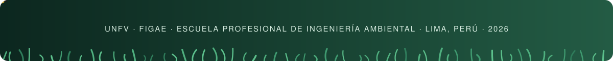

<p align="center">
  
</p>

<p align="center">
  
  
  
  
</p>

<p align="center">
  <em>Repositorio de los trabajos del grupo <strong>Las Abejitas</strong> en el curso de Evaluación y Monitoreo de Flora, Fauna y Sistemas Ecológicos:<br>
  de la formación del ingeniero ambiental al trabajo con datos reales de campo e institucionales.</em>
</p>

---

## Sobre el curso

<table>
  <tr><td><strong>Universidad</strong></td><td>Universidad Nacional Federico Villarreal (UNFV)</td></tr>
  <tr><td><strong>Facultad</strong></td><td>Facultad de Ingeniería Geográfica, Ambiental y Ecoturismo (FIGAE)</td></tr>
  <tr><td><strong>Escuela</strong></td><td>Escuela Profesional de Ingeniería Ambiental</td></tr>
  <tr><td><strong>Asignatura</strong></td><td>Evaluación y Monitoreo de Flora, Fauna y Sistemas Ecológicos</td></tr>
  <tr><td><strong>Docente</strong></td><td>Ing. Cuya Matos, Oscar Alejandro</td></tr>
  <tr><td><strong>Semestre</strong></td><td>2026-II · Lima, Perú</td></tr>
</table>

## El equipo

<p align="center">
  
</p>

<details>
<summary><strong>Ver integrantes en tabla</strong></summary>

| N.º | Integrante | Código |
|:---:|---|:---:|
| 01 | Guardia Romero, Ángel David | 2024021549 |
| 02 | Ordoñez Ramos, Esthif Jordy | 2024021736 |
| 03 | Paucar Donayre, Mathias Salvador | 2024021772 |
| 04 | Paucar Quispe, Cielo Margoth | 2024021763 |
| 05 | Ramirez Pastrana, Katerin Yasuri | 2024021852 |
| 06 | Salvatierra Quispe, Giuliana Anais Amalia | 2024021914 |
| 07 | Sotomayor Acosta, Raulino Matsue | 2024034643 |
| 08 | Villegas Estrella, Lesli Sandra | 2024022056 |

</details>

> **¿Por qué "Las Abejitas"?** Las abejas son polinizadoras y uno de los mejores indicadores de la salud de un ecosistema: donde hay abejas, hay flora y hay vida. Como en un panal, cada integrante aporta una celda al trabajo común.

## Prácticas

<p align="center">
  
</p>

| | Práctica | Modalidad | Carpeta |
|:---:|---|:---:|:---:|
| **1** | Competencias teóricas, prácticas y actitudinales que requiere un ingeniero ambiental para atender instrumentos de gestión ambiental que incluyen la evaluación y monitoreo de flora, fauna y sistemas ecológicos | Individual | [📂 practica-01](practica-01) |
| **2** | Diagnóstico de brechas entre las competencias profesionales del ingeniero ambiental y las exigencias reales de evaluación de instrumentos de gestión ambiental | Grupal | [📂 practica-02](practica-02) |
| **3** | Evaluación de flora y vegetación en las Lomas de Lachay: mapa fisionómico de vegetación, inventario por relevés y evaluación poblacional de especies amenazadas | Grupal | [📂 practica-03](practica-03) |
| **4** | Base de datos, secuestro de carbono e inteligencia artificial: curaduría FAIR del registro de plantaciones forestales del SERFOR | Grupal | [📂 practica-04](practica-04) |
| **5** | Práctica 5 | Grupal | [📂 practica-05](practica-05) |

<p>
  La práctica 4 también tiene su propio repositorio, <a href="https://github.com/jordyordonezramos53-debug/practica-carbono-plantaciones">practica-carbono-plantaciones</a>, archivado en Zenodo:
  <a href="https://doi.org/10.5281/zenodo.24328237"></a>
</p>

## Cómo está organizado

```
evaluacion-monitoreo-flora-fauna/
├── practica-01/      Individual: una carpeta por integrante
├── practica-02/      Grupal
├── practica-03/      Grupal
├── practica-04/      Grupal: datos, scripts y documentos de la práctica de carbono
├── practica-05/      Grupal
└── assets/           Imágenes de esta portada
```

---

<p align="center">
  
</p>
