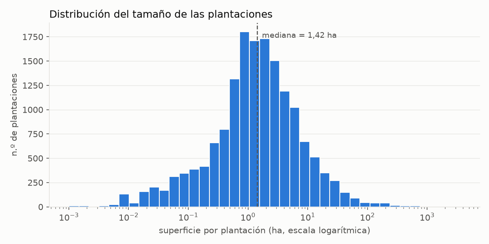
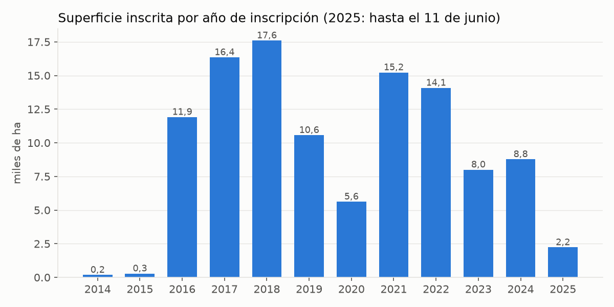
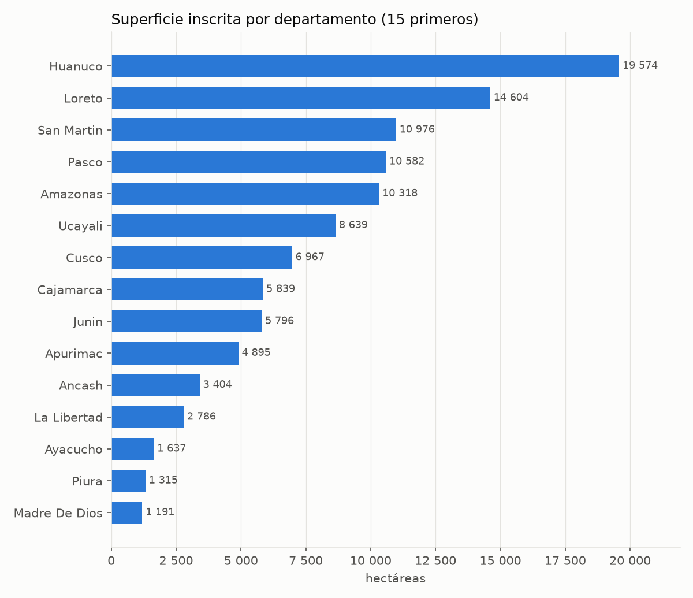
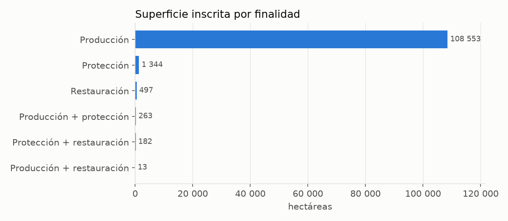
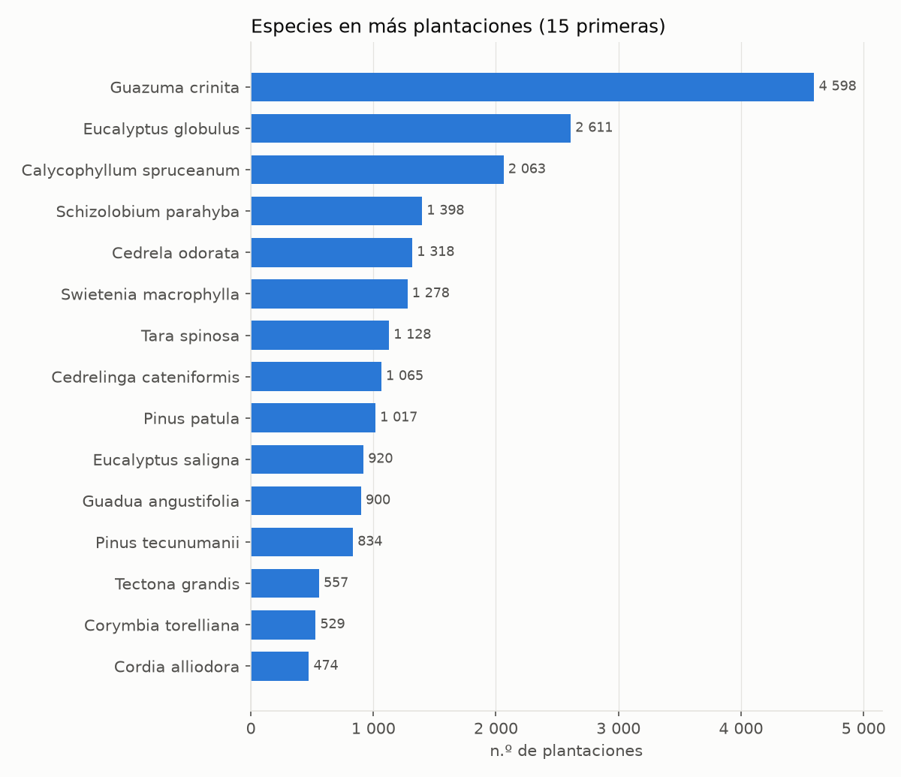
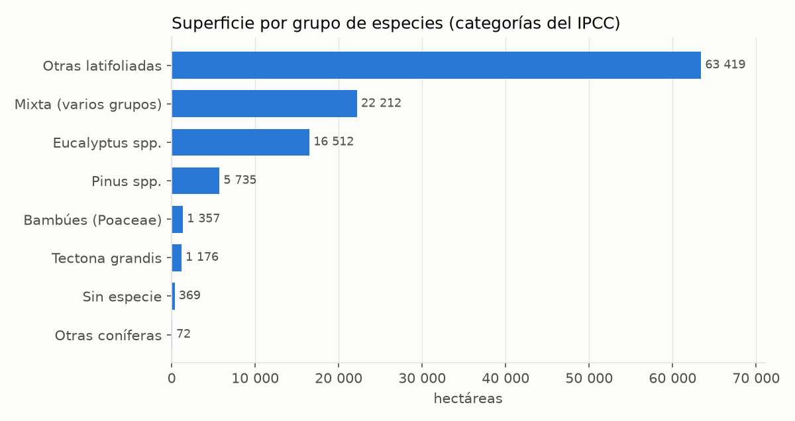

# Entregable 9. Análisis exploratorio de datos

**Script:** [`scripts/04_analisis_exploratorio.py`](../scripts/04_analisis_exploratorio.py) · **Tablas:** [`data/processed/eda/`](../data/processed/eda/) · **Gráficos:** [`figures/`](../figures/)

Toda la superficie se calculó con la tabla **por plantación**, contando cada plantación una vez. Se excluyeron las 9 plantaciones con superficie de 0 ha.

## 1. Resumen general

| Indicador | Valor |
|---|---|
| Plantaciones inscritas | 16 204 (16 195 con superficie válida) |
| Superficie total | **110 852 ha** |
| Superficie mediana / media | 1,42 ha / 6,84 ha |
| Superficie del 10 % de plantaciones más grandes | **73,8 %** del total |
| Titulares distintos | 12 921 |
| Especies distintas (nombre aceptado) / familias | 519 / 89 |
| Plantaciones de una sola especie / mixtas | 10 429 / 5714 |
| Plantaciones de menos de 0,01 ha (100 m²) | 83 (posibles errores de unidad; quedan marcadas y se excluyen en el análisis de sensibilidad del proyecto) |

## 2. Patrones

### 2.1 Tamaño: muchas plantaciones pequeñas, pocas muy grandes

| Rango (ha) | % de plantaciones | % de superficie |
|---|---|---|
| < 1 | 37,7 | 2,2 |
| 1-5 | 42,3 | 13,9 |
| 5-10 | 9,6 | 9,7 |
| 10-50 | 8,7 | 25,3 |
| 50-100 | 0,8 | 8,0 |
| 100-500 | 0,7 | 20,5 |
| > 500 | 0,1 | 20,5 |

El 80 % de las plantaciones mide menos de 5 ha, pero solo suma el 16 % de la superficie. Las **22 plantaciones de más de 500 ha concentran el 20,5 %**. Cualquier estimación de carbono dependerá mucho de esas pocas plantaciones grandes, y por eso conviene verificarlas.

### 2.2 Evolución de las inscripciones

La superficie inscrita alcanza su máximo en 2017-2018 (16 000-17 600 ha por año) y vuelve a subir en 2021-2022. El dato de 2025 está incompleto, porque el corte es del 11 de junio. **Es el año de inscripción, no el de plantación**, así que no indica la edad de los árboles.

### 2.3 Distribución geográfica

Cinco departamentos reúnen casi el 60 % de la superficie: Huánuco (17,7 %), Loreto (13,2 %), San Martín (9,9 %), Pasco (9,5 %) y Amazonas (9,3 %). San Martín tiene más plantaciones (3575) pero más pequeñas. Loreto tiene menos plantaciones, pero de mayor tamaño.

### 2.4 Finalidad: casi todo es producción

El **97,9 %** de la superficie es de **producción**. Solo unas 2000 ha (1,8 %) tienen finalidad **exclusivamente** de protección o restauración. Esto importa para el carbono: las plantaciones de producción se cosechan, así que su almacenamiento es **temporal**.

### 2.5 Especies

Predominan especies nativas amazónicas de crecimiento rápido: bolaina (*Guazuma crinita*), capirona (*Calycophyllum spruceanum*) y pashaco (*Schizolobium parahyba*). Las siguen especies exóticas andinas como *Eucalyptus globulus* y *Pinus patula*. También aparecen especies maderables valiosas: cedro (*Cedrela odorata*), caoba (*Swietenia macrophylla*) y tornillo (*Cedrelinga cateniformis*).

> Nota taxonómica: GBIF reasigna *Schizolobium amazonicum* a *S. parahyba*, con lo que se pierde la variedad *amazonicum*. Para un análisis por especie conviene revisarlo con World Flora Online.

### 2.6 Grupos de especies para la estimación de carbono

| Grupo | Superficie (ha) | % |
|---|---|---|
| Otras latifoliadas | 63 419 | 57,2 |
| Mixta (varios grupos) | 22 212 | 20,0 |
| *Eucalyptus* spp. (incluye *Corymbia*) | 16 512 | 14,9 |
| *Pinus* spp. | 5735 | 5,2 |
| Bambúes (Poaceae) | 1357 | 1,2 |
| *Tectona grandis* | 1176 | 1,1 |
| Sin especie | 369 | 0,3 |
| Otras coníferas | 72 | 0,1 |

Casi el **80 %** de la superficie puede asignarse a un solo grupo de especies, lo que permite aplicar factores de crecimiento del IPCC por grupo. El **20 % son plantaciones mixtas** sin proporción conocida entre especies: solo pueden tratarse con un factor promedio o un rango.

## 3. Vacíos de información

| Variable | Situación | Consecuencia |
|---|---|---|
| Coordenadas o polígonos | No existen | No se puede asignar la zona ecológica del IPCC ni verificar con imágenes satelitales |
| Año de plantación o edad | No existe (solo el año de inscripción) | No se puede estimar el crecimiento acumulado |
| Supervivencia o estado actual | No existe | No se sabe cuánta superficie inscrita sigue en pie |
| Proporción de especies en plantaciones mixtas | No existe | 5714 plantaciones no se pueden asignar a una sola especie |
| DAP, altura, densidad | No existen | No se pueden usar ecuaciones alométricas |
| Especie | 168 filas sin dato | Menor |

## 4. Implicaciones para la investigación

1. Con estos datos es viable una **estimación de nivel 1 de remociones potenciales**: superficie × factores del IPCC por grupo de especies, desagregada por departamento y finalidad.
2. La incertidumbre principal no viene de los factores, sino de la **superficie efectiva**, porque no se sabe cuánta superficie inscrita está realmente plantada y en pie. La investigación debe presentar sus resultados como un **límite superior**.
3. La distinción entre producción (97,9 %) y protección o restauración es clave para hablar de **permanencia**.
4. Las 22 plantaciones de más de 500 ha y las 83 de menos de 0,01 ha quedan marcadas. El proyecto las trata con un análisis de sensibilidad que las excluye (`docs/10`, sección 11), porque confirmarlas exige imágenes satelitales o datos del SERFOR que no están en el registro.
